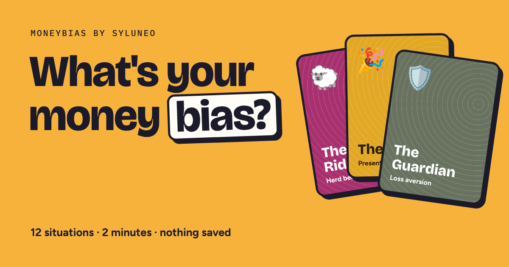

# Syluneo · MoneyBias

**Live site:** [syluneo.com](https://syluneo.com)



MoneyBias is a free, privacy-first web app that helps students and young Indians understand their money habits:

- **A 2-minute money-personality quiz.** 12 everyday money moments reveal which behavioural bias may steer your spending: loss aversion, herd behaviour, overconfidence, present bias, anchoring or mental accounting.
- **Six calculators for real decisions:**
  - Should I buy this?
  - Real discount checker
  - Credit card trap calculator (minimum-due repayment, interest plus 18% GST)
  - No-cost EMI check
  - Lifestyle inflation trap
  - Inflation reality check
- **Face-Off** compares two money types, and **The science** lists the research behind each bias, with verifiable references.

## Privacy by design

- No accounts and no cookies.
- Every calculation runs in the browser. Nothing a visitor types is ever sent anywhere.
- Fonts and scripts are self-hosted.
- Visits are counted only as anonymous totals with GoatCounter.

See the [Privacy Policy](https://syluneo.com/privacy-policy.html).

## How it's built

- Plain HTML, CSS and JavaScript, with no framework and no build step. It's hosted on GitHub Pages.
- All money maths lives in one pure module and is covered by 132 unit tests (`tests/calc_test.js`). This includes reducing-balance EMI, statement-by-statement credit card repayment with three minimum-due rules, GST on interest, inflation and real discounts.
- Quiz scoring was checked exhaustively across all 16.7 million answer combinations to make sure no type is favoured.
- The pages pass an axe-core accessibility audit, and they're tested from 320px phone width upwards.

Run the maths tests (Node.js):

```
node tests/calc_test.js moneybias/index.html
```

## Disclaimer

Syluneo is for learning and planning. It is not financial advice, and Syluneo is not registered with SEBI as an investment adviser. The quiz is a self-reflection game, not a validated psychological test.
